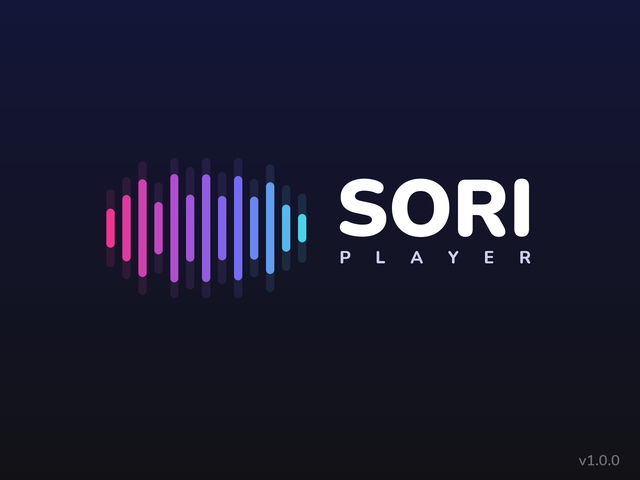
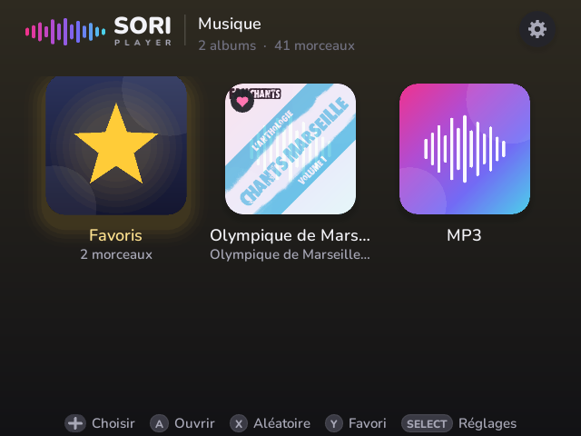
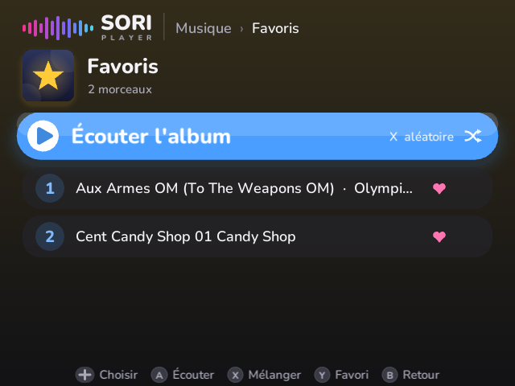
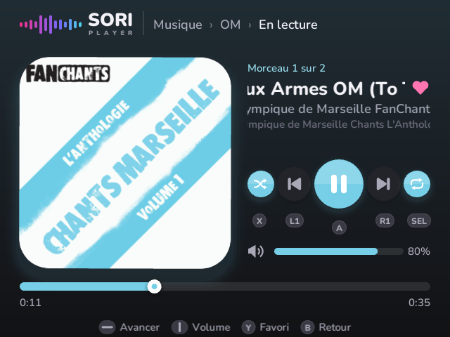
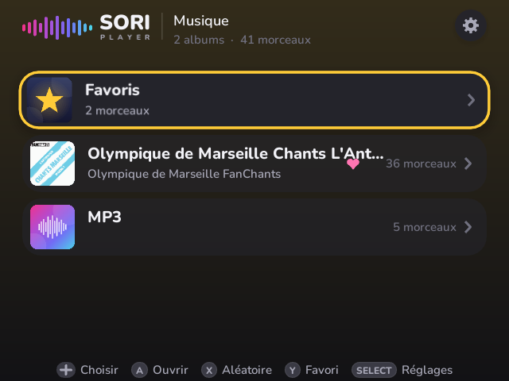
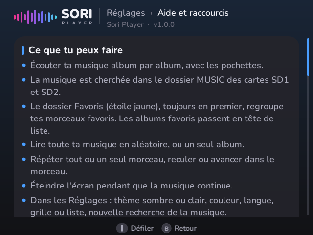
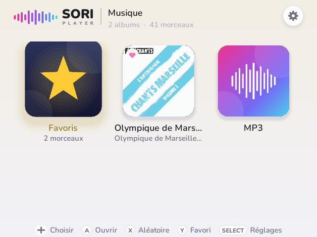
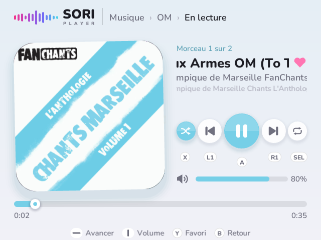

  <picture>
    <source media="(prefers-color-scheme: dark)" srcset="docs/logo-dark.png">
    
  </picture>

# Sori Player

A music player for **muOS** handheld consoles, made with [LÖVE](https://love2d.org/).
Albums with cover art, favorites, shuffle, and the screen can turn off while the music keeps playing.

*Version française : [LISEZMOI.md](LISEZMOI.md)*

## Screenshots

<table>
  <tr>
    <td align="center"> Splash screen</td>
    <td align="center"> Albums (grid) with the Favorites folder</td>
  </tr>
  <tr>
    <td align="center"> Inside an album</td>
    <td align="center"> Now playing</td>
  </tr>
  <tr>
    <td align="center"> List view</td>
    <td align="center"> Built-in help and shortcuts</td>
  </tr>
  <tr>
    <td align="center"> Light theme</td>
    <td align="center"> Now playing, light theme</td>
  </tr>
</table>

## Features

- Browse your music **album by album**, with cover art (`cover.jpg`/`folder.jpg`… in the folder, or embedded in the tags). Folders without art get a Sori tile.
- While playing, a track with its **own embedded cover** (e.g. added with Mp3tag) shows it; otherwise the album cover is used.
- Scans the **`MUSIC` folder on both SD cards** (`/mnt/mmc/MUSIC` and `/mnt/sdcard/MUSIC`, any capitalisation).
- MP3, FLAC, OGG and WAV.
- **Favorites** folder (yellow star), always first, with all your favorite tracks. Favorite albums move to the top of the list.
- **Shuffle** all your music or a single album, repeat all / one track, seek ±10 s.
- **Screen off, music on**: press Menu, or let it turn off by itself after 60 s without a button press while playing.
- Browse **by album or by artist** (Settings). An artist shows all their albums, plus a **No album** folder for tracks without an album tag.
- Dark or light theme, accent colour, grid or list view.
- 6 languages: English, French, Spanish, Portuguese, Italian, German (automatic = console language).
- Built-in **Help and shortcuts** page (Settings).

## Requirements

- A console running **muOS**. Tested on **Anbernic RG40XXV** with **muOS 2606.0 (Andromeda)**.
- The **LÖVE 11.5** runtime. Sori Player uses the one from **PortMaster** (`MUOS/PortMaster/runtimes/love_11.5`), which is installed along with any LÖVE port. You can also put a `love` binary in `SoriPlayer/bin/` (with its libraries in `bin/lib/`).

## Installation

1. Download `SoriPlayer-vX.Y.Z.zip` from the [Releases](../../releases) page.
2. Extract it and copy the **`SoriPlayer`** folder to **`/Primary Storage/MUOS/application/`** (the `MUOS/application` folder of your primary SD card).
3. Put your music in a **`MUSIC`** folder at the root of SD1 and/or SD2, one folder per album.
4. Launch **Sori Player** from **Applications**.

Optional settings are in `sori.cfg` (extra music folders, screen-off delay, button swaps…).

## Controls

| Where | Button | Action |
|---|---|---|
| Everywhere | L1 / R1 | Previous / next track |
| | L1 + R1 | Shuffle all your music |
| | L2 / R2 | Volume down / up |
| | Menu | Turn the screen off (music keeps playing) |
| | Menu + Start | Quit |
| Album list | A | Open |
| | X | Shuffle all |
| | Y | Favorite album |
| | Start | Now playing screen |
| | Select | Settings (and Help) |
| Inside an album | A | Play the album / the selected track |
| | X | Shuffle the album |
| | Y | Favorite track (on "Play album": favorite album) |
| | B | Back |
| Now playing | A | Play / pause |
| | X | Shuffle on / off |
| | Y | Favorite track |
| | Select | Repeat: off, all, one |
| | ← / → | Back / forward 10 s |
| | ↑ / ↓ | Volume |
| Screen off | any button | Turn the screen back on (L1, R1, L2, R2 work without waking it) |

> Don't use the **Power** button to turn off the screen: it puts the console to sleep and stops the music.
> In muOS, set **Configuration › Power › Idle Input Sleep Timeout** to *Disabled* so the console doesn't suspend while you listen.

## Troubleshooting

- Something wrong? Check `sori.log` in the app folder.
- A/B or X/Y swapped on your console: add `inverser_ab=1` or `inverser_xy=1` to `sori.cfg` (`debug_input=1` shows the detected buttons).

## License

Code: [MIT](LICENSE) © jeromarsan.
Font: Nunito, SIL Open Font License 1.1 ([assets/Nunito-OFL.txt](assets/Nunito-OFL.txt)).
